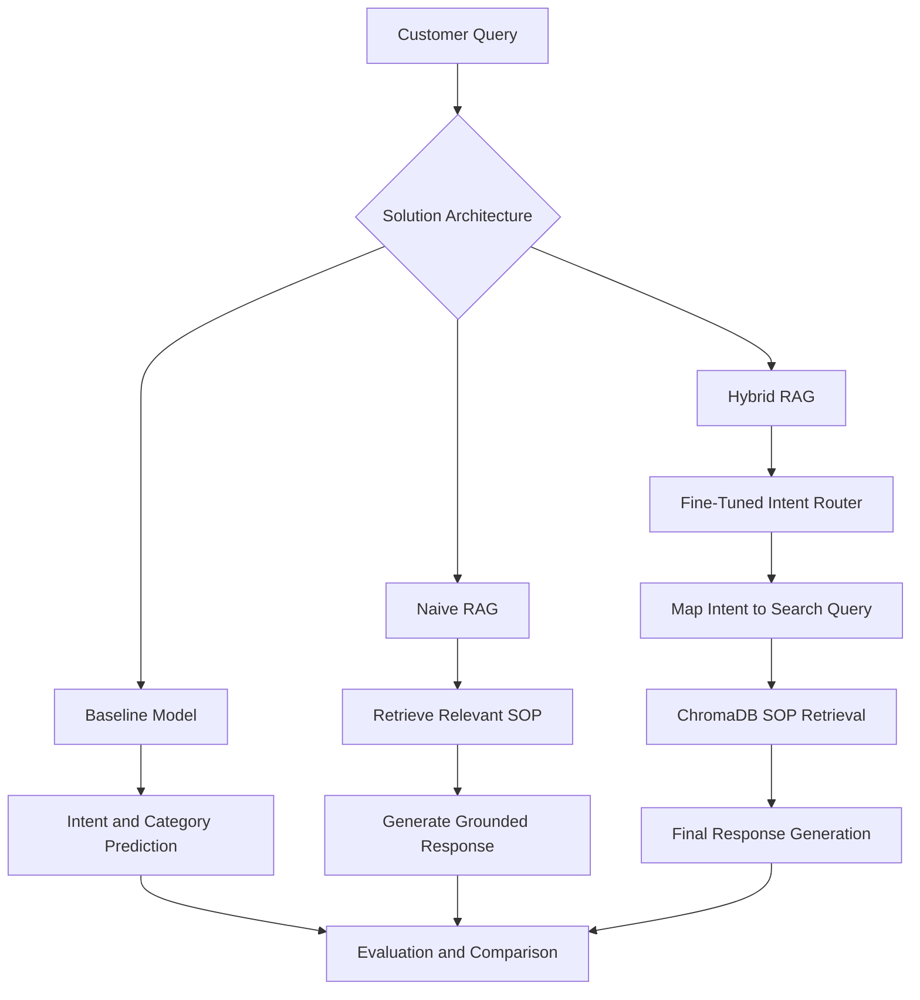

# # Hybrid RAG: Fine-Tuned for Customer Support

**An end-to-end customer support NLP project combining intent classification, Retrieval-Augmented Generation (RAG), and parameter-efficient fine-tuning to build a policy-aware support pipeline.**

## Overview

Customer support systems need to understand customer queries, identify the correct intent, and retrieve relevant policy information before generating a response. A standard language model may misclassify requests or produce answers that are not grounded in the organization's documented procedures.

This project explores three progressively more capable approaches:

1. **Baseline Model** — A pretrained instruction-following language model predicts the customer's intent and category.
2. **Naive RAG** — Retrieves relevant Standard Operating Procedure (SOP) documents from a vector database and incorporates them into the response-generation workflow.
3. **Hybrid RAG** — Combines a fine-tuned intent-routing model with SOP retrieval and a final response-generation stage.

The objective is to evaluate the contribution of retrieval and fine-tuning separately, then compare all three approaches using consistent evaluation criteria.

## Architecture



## Tech Stack

| Component                   | Technologies                               |
| --------------------------- | ------------------------------------------ |
| Programming                 | Python                                     |
| Language model              | Qwen2.5-1.5B-Instruct                      |
| Model fine-tuning           | Hugging Face Transformers, PEFT, LoRA      |
| Quantization                | BitsAndBytes                               |
| Embeddings                  | Sentence Transformers — `all-MiniLM-L6-v2` |
| Vector database             | ChromaDB                                   |
| Retrieval and orchestration | LangChain                                  |
| Data processing             | Pandas, NumPy                              |
| Evaluation                  | Scikit-learn, ROUGE, BLEU                  |
| Training and visualization  | PyTorch, Matplotlib, Seaborn               |
| Execution environment       | Kaggle notebooks with GPU support          |

## Project Workflow

### 1. Data Understanding and Exploratory Data Analysis

* Explore the Bitext customer support dataset and its intent/category distribution.
* Inspect missing values, duplicates, and data quality.
* Analyze frequent intents and relationships within the data.
* Examine SOP documents using TF-IDF vectorization and cosine similarity.
* Visualize patterns that may influence classification and document retrieval.

### 2. Data Preparation and Instruction Tuning

* Clean and standardize intent, category, and instruction fields.
* Convert records into ChatML instruction-tuning format.
* Define assistant targets as JSON containing `intent` and `category`.
* Tokenize the instruction dataset and mask padding tokens in the training labels.
* Analyze token-length distributions and potential truncation.
* Create stratified training, validation, and held-out test partitions.
* Prepare SOP documents for downstream retrieval.

### 3. Baseline Model Evaluation

* Run the pretrained Qwen model on held-out customer queries.
* Parse model outputs into structured intent/category predictions.
* Save the predictions for downstream comparison.
* Inspect output formatting and baseline classification behavior.

### 4. Naive RAG Implementation

* Load Markdown SOP documents into LangChain document objects.
* Generate document embeddings using `all-MiniLM-L6-v2`.
* Build a persistent ChromaDB vector index.
* Retrieve the most relevant SOP for each customer query.
* Incorporate retrieved context into the generation prompt.
* Save RAG outputs and their associated source metadata.

### 5. Solution V1 — RAG Evaluation

Evaluate the baseline and Naive RAG pipelines using:

* Output format adherence
* SOP-grounded ROUGE-1 and ROUGE-L scores
* BLEU scores
* Output consistency under deterministic decoding
* Unsupported claims and potential hallucinations
* Comparative metrics to examine the contribution of retrieval

The results are exported to `v1_metrics.csv` for use in subsequent evaluation stages.

### 6. Fine-Tuning Pipeline

Fine-tune the intent-routing model using parameter-efficient adaptation rather than updating the entire base model.

The pipeline includes:

* Loading tokenized training and validation datasets.
* Configuring LoRA adapters on the `q_proj` and `v_proj` attention modules.
* Applying quantization-aware model loading.
* Training with a custom PyTorch loop and AdamW optimization.
* Monitoring training and validation loss.
* Implementing early stopping based on validation performance.
* Saving the best and final adapter checkpoints.
* Exporting the training log and loss curves.

**Training artifacts:**

* `intent_lora_best/`
* `intent_lora/`
* `training_log.csv`
* `training_curves.png`

### 7. Solution V2 — Hybrid RAG Evaluation

Integrate the fine-tuned intent router with the existing retrieval pipeline.

The workflow is:

1. Receive a customer query.
2. Predict the intent using the fine-tuned model.
3. Map the predicted intent to a retrieval-oriented search query.
4. Retrieve the corresponding SOP context from ChromaDB.
5. Generate the final response using the retrieved information.
6. Evaluate the integrated pipeline against the held-out data.

The evaluation framework includes format adherence, exact and fuzzy intent matching, ROUGE/BLEU, adversarial-query evaluation, and comparison with the Naive RAG results.

The final comparison is designed to isolate the contribution of fine-tuning while keeping the retrieval component in place.

## Evaluation Framework

The project uses multiple evaluation dimensions rather than relying on a single score.

| Metric                  | Purpose                                                              |
| ----------------------- | -------------------------------------------------------------------- |
| Format adherence        | Measures whether model outputs follow the expected structure         |
| Exact intent match      | Measures exact agreement between predicted and expected intents      |
| Fuzzy intent match      | Examines partial or approximate agreement                            |
| ROUGE-1                 | Measures unigram overlap with the reference response                 |
| ROUGE-L                 | Measures longest-common-subsequence overlap                          |
| BLEU                    | Measures n-gram precision against reference text                     |
| Output consistency      | Checks whether repeated deterministic runs produce identical outputs |
| Hallucination frequency | Assesses claims unsupported by the retrieved SOP context             |

ROUGE and BLEU measure textual overlap, not factual correctness by themselves. Results should therefore be interpreted alongside SOP grounding and classification metrics.

## Repository Structure

```text
Hybrid-RAG-Customer-Support/
│
├── Data_Understanding_and_EDA.ipynb
├── Data_Preparation.ipynb
├── baseline-model-evaluation.ipynb
├── rag-implementation.ipynb
├── solution-v1-rag-evaluation.ipynb
├── fine-tuning-pipeline.ipynb
├── Solution-V2-Fine-Tuned-RAG-Evaluation.ipynb
│
├── corporate_policies/
│   └── *.md
│
├── artifacts/
│   ├── sampled_data.csv
│   ├── df_test.csv
│   ├── outputs.json
│   ├── v1_metrics.csv
│   ├── training_log.csv
│   └── training_curves.png
│
├── chroma_db/
├── intent_lora_best/
├── intent_lora/
│
└── README.md
```

*This is the logical project structure; generated artifacts and model checkpoints may be stored in Kaggle input/output locations rather than committed to GitHub.*

## Getting Started

### Prerequisites

* Python 3.10 or a compatible environment for the selected dependency versions.
* A GPU-enabled Kaggle notebook environment for model inference and fine-tuning.
* Access to the Bitext customer support dataset.
* The Markdown SOP documents in `corporate_policies/`.
* Hugging Face model/tokenizer access and the dependencies used by the notebooks.

### Execution Order

Run the notebooks in the following order:

| Order | Notebook                                        | Purpose                                                   |
| ----- | ----------------------------------------------- | --------------------------------------------------------- |
| 1     | `Data_Understanding_and_EDA.ipynb`              | Explore and validate the dataset                          |
| 2     | `Data_Preparation.ipynb`                        | Prepare instruction-tuning data and data splits           |
| 3     | `baseline-model-evaluation.ipynb`               | Generate baseline predictions                             |
| 4     | `rag-implementation.ipynb`                      | Build the SOP vector index and generate Naive RAG outputs |
| 5     | `solution-v1-rag-evaluation.ipynb`              | Evaluate baseline and Naive RAG                           |
| 6     | `fine-tuning-pipeline.ipynb`                    | Train and save LoRA adapters                              |
| 7     | `Solution V2 — Fine-Tuned RAG Evaluation.ipynb` | Evaluate Hybrid RAG and compare approaches                |

**Important:** Each stage depends on artifacts created by earlier notebooks. Update dataset, checkpoint, and artifact paths to match your environment.

## Key Engineering Considerations

* **Data leakage prevention:** Use the held-out test partition for final evaluation, not model training.
* **Structured outputs:** Validate model predictions before calculating classification metrics.
* **Policy grounding:** Evaluate generated responses against relevant SOP documents rather than generic references.
* **Reproducibility:** Record model configuration, training parameters, random seeds, and checkpoint selection.
* **Fair comparisons:** Use consistent test examples and metric definitions when comparing baseline, Naive RAG, and Hybrid RAG.
* **Resource efficiency:** Use parameter-efficient fine-tuning and quantization to reduce training memory requirements.

## Results

The project is structured to compare three approaches:

* **Baseline:** Establishes the performance of the pretrained instruction-following model.
* **Naive RAG:** Examines whether retrieving SOP context improves the response pipeline.
* **Hybrid RAG:** Examines whether fine-tuned intent routing improves retrieval and downstream response quality.

Final numerical results should be added after the full evaluation has been run and verified. No improvement percentage is claimed here without validated, comparable results.

## Future Improvements

* Improve intent-routing accuracy for ambiguous customer requests.
* Introduce retrieval-ranking strategies beyond top-1 similarity search.
* Evaluate retrieval quality independently from response quality.
* Add automated checks for unsupported policy claims.
* Expand adversarial testing for negation, repeated complaints, and frustrated customers.
* Compare LoRA configurations and training hyperparameters.
* Add an API or interactive interface for demonstrating the end-to-end pipeline.

## Conclusion

This project demonstrates an end-to-end approach to customer support automation by combining **instruction-tuned intent classification, vector-based SOP retrieval, and parameter-efficient fine-tuning**. Its staged evaluation framework helps distinguish the contribution of retrieval from the contribution of fine-tuning, while emphasizing structured outputs, policy grounding, and reproducible experimentation.

---

**Author:** Piyush Sharma

**Focus Areas:** NLP · Generative AI · Retrieval-Augmented Generation · LLM Fine-Tuning · Customer Support Automation
-
