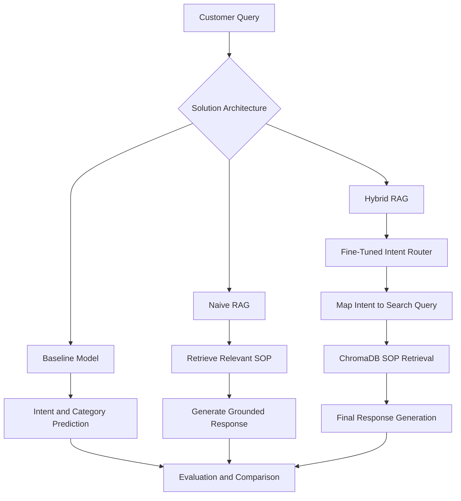

# Hybrid RAG: Fine-Tuned for Customer Support

**An end-to-end customer support NLP project combining intent classification, Retrieval-Augmented Generation (RAG), and parameter-efficient fine-tuning to build a policy-aware support pipeline.**

## Overview

Customer support systems need to understand customer queries, identify the correct intent, and retrieve relevant policy information before generating a response. A standard language model may misclassify requests or produce answers that are not grounded in the organization's documented procedures.

This project explores three progressively more capable approaches:

1. **Baseline Model** — A pretrained instruction-following language model predicts the customer's intent and category.
2. **Naive RAG (Solution V1)** — Retrieves the most relevant Standard Operating Procedure (SOP) document from a vector database using the raw query and incorporates it into the prompt.
3. **Hybrid RAG (Solution V2)** — Combines a LoRA fine-tuned intent-routing model with SOP retrieval and a final response-generation stage.

The objective is to evaluate the contribution of retrieval and fine-tuning separately, then compare all three approaches using consistent evaluation criteria.

## Architecture



## Tech Stack

| Component                   | Technologies                               |
| --------------------------- | ------------------------------------------ |
| Programming                 | Python                                     |
| Language model              | Qwen2.5-1.5B-Instruct (4-bit NF4)          |
| Model fine-tuning           | Hugging Face Transformers, PEFT, LoRA      |
| Quantization                | BitsAndBytes                               |
| Embeddings                  | Sentence Transformers — `all-MiniLM-L6-v2` |
| Vector database             | ChromaDB                                   |
| Retrieval and orchestration | LangChain                                  |
| Data processing             | Pandas, NumPy                              |
| Evaluation                  | Scikit-learn, ROUGE, BLEU                  |
| Training and visualization  | PyTorch, Matplotlib, Seaborn               |
| Execution environment       | Local Jupyter (notebooks 1–2), Kaggle T4 GPU (notebooks 3–7) |

## Project Workflow

### 1. Data Understanding and Exploratory Data Analysis

* Explore the Bitext customer support dataset (26,872 rows) and a 4,000-row working sample covering 27 intents and 11 categories.
* Inspect missing values, duplicates, and data quality.
* Analyze frequent intents and prompt-length distribution.
* Examine the 13 SOP documents using TF-IDF vectorization and cosine similarity.

### 2. Data Preparation and Instruction Tuning

* Clean and standardize intent (lowercase), category (uppercase), and instruction fields; remove duplicates (3,902 rows remain).
* Convert records into ChatML instruction-tuning format.
* Define assistant targets as JSON containing `intent` and `category`.
* Tokenize the dataset (max length 128) and mask padding tokens **and all prompt tokens** (everything up to the assistant header) with `-100`, so the training loss covers only the JSON answer.
* Analyze token-length distributions and potential truncation.
* Create stratified 80/10/10 training, validation, and held-out test partitions (3,121 / 390 / 391 rows).
* Prepare SOP documents for downstream retrieval.

> Note: the Task 2.3.1 markdown in the data-preparation notebook still describes padding-only masking; the implementation additionally masks prompt tokens.

### 3. Baseline Model Evaluation

* Run the pretrained Qwen model on all 391 held-out customer queries.
* Parse model outputs into structured intent/category predictions.
* Save the predictions for downstream comparison.

### 4. Naive RAG Implementation

* Load Markdown SOP documents into LangChain document objects.
* Generate document embeddings using `all-MiniLM-L6-v2`.
* Build a persistent ChromaDB vector index.
* Retrieve the most relevant SOP (top-1) for each customer query.
* Incorporate retrieved context into the generation prompt.
* Save RAG outputs and their associated source metadata.

### 5. Solution V1 — RAG Evaluation

Evaluate the baseline and Naive RAG pipelines (live, on a 50-row sample) using:

* Output format adherence
* SOP-grounded ROUGE-1 and ROUGE-L scores
* BLEU scores
* Output consistency under deterministic decoding
* Unsupported claims and potential hallucinations

The results are exported to `v1_metrics.csv`.

### 6. Fine-Tuning Pipeline

Fine-tune the intent-routing model using parameter-efficient adaptation rather than updating the entire base model.

* LoRA adapters (r=16, alpha=32, dropout 0.05) on the `q_proj` and `v_proj` attention modules — 2,179,072 trainable parameters (0.141%).
* 4-bit NF4 quantization-aware model loading.
* Custom PyTorch training loop with AdamW, constant learning rate 2e-4, batch size 4, 800 steps (about one epoch).
* Validation every 10 steps with early stopping (patience 3); early stopping did not trigger.
* Best validation loss 0.3203 (step 780); validation loss fell from 2.42 at step 10.
* Best and final adapter checkpoints, training log, and loss curves saved.

**Training artifacts:**

* `intent_lora_best/`
* `intent_lora/`
* `training_log.csv`
* `training_curves.png`

### 7. Solution V2 — Hybrid RAG Evaluation

Integrate the fine-tuned intent router with the existing retrieval pipeline.

1. Receive a customer query.
2. Predict the intent with the fine-tuned router, using the same system prompt as in training.
3. Map the predicted intent to a retrieval-oriented search string (e.g. `track_order` → "Track Order"), falling back to the raw query if the router output is not valid JSON.
4. Retrieve the top SOP from ChromaDB.
5. Generate the final response with the retrieved SOP as context.
6. Evaluate on all 391 held-out rows and on an adversarial subset (101 rows matched by hedging/difficulty words extracted from the data).

## Evaluation Framework

| Metric                  | Purpose                                                              |
| ----------------------- | -------------------------------------------------------------------- |
| Format adherence        | Share of outputs that parse as valid JSON (V2: final response; router-only reported separately) |
| Exact intent match      | Exact agreement between predicted and expected intents               |
| Fuzzy intent match      | At least half of the true label's words appear in the prediction     |
| ROUGE-1                 | Unigram overlap with the SOP-grounded reference                      |
| ROUGE-L                 | Longest-common-subsequence overlap                                   |
| BLEU                    | N-gram precision against the reference                               |
| Output consistency      | Identical outputs across repeated greedy runs (5 queries × 3 runs)   |
| Hallucination frequency | Responses containing claims (timelines, "department X", "call us at", "tracking number X") not in the reference SOP |

ROUGE and BLEU measure textual overlap, not factual correctness by themselves. All systems emit short JSON labels while references are prose SOPs, so these scores are very low for every system and do not separate them.

## Repository Structure

```text
Hybrid-RAG-Customer-Support/
│
├── Data_Understanding_and_EDA.ipynb
├── Data_Preparation.ipynb
├── baseline-model-evaluation.ipynb
├── rag-implementation.ipynb
├── solution-v1-rag-evaluation.ipynb
├── fine-tuning-pipeline.ipynb
├── Solution-V2-Fine-Tuned-RAG-Evaluation.ipynb
│
├── corporate_policies/
│   └── *.md
│
├── artifacts/
│   ├── sampled_data.csv
│   ├── df_test.csv
│   ├── outputs.json
│   ├── v1_metrics.csv
│   ├── training_log.csv
│   └── training_curves.png
│
├── chroma_db/
├── intent_lora_best/
├── intent_lora/
│
└── README.md
```

*This is the logical project structure; generated artifacts and model checkpoints may be stored in Kaggle input/output locations rather than committed to GitHub.*

## Getting Started

### Prerequisites

* Python 3.10 or a compatible environment for the selected dependency versions.
* A GPU-enabled Kaggle notebook environment for model inference and fine-tuning.
* Access to the Bitext customer support dataset.
* The Markdown SOP documents in `corporate_policies/`.
* Hugging Face model/tokenizer access and the dependencies used by the notebooks.

### Execution Order

Run the notebooks in the following order:

| Order | Notebook                                        | Purpose                                                   |
| ----- | ----------------------------------------------- | --------------------------------------------------------- |
| 1     | `Data_Understanding_and_EDA.ipynb`              | Explore and validate the dataset                          |
| 2     | `Data_Preparation.ipynb`                        | Prepare instruction-tuning data and data splits           |
| 3     | `baseline-model-evaluation.ipynb`               | Generate baseline predictions                             |
| 4     | `rag-implementation.ipynb`                      | Build the SOP vector index and generate Naive RAG outputs |
| 5     | `solution-v1-rag-evaluation.ipynb`              | Evaluate baseline and Naive RAG                           |
| 6     | `fine-tuning-pipeline.ipynb`                    | Train and save LoRA adapters                              |
| 7     | `Solution V2 — Fine-Tuned RAG Evaluation.ipynb` | Evaluate Hybrid RAG and compare approaches                |

**Important:** Each stage depends on artifacts created by earlier notebooks. Update dataset, checkpoint, and artifact paths to match your environment.

## Key Engineering Considerations

* **Data leakage prevention:** The held-out test partition (391 rows) is never used in training or validation; split overlap was checked with set intersections.
* **Structured outputs:** Model predictions are validated as JSON before classification metrics are calculated.
* **Policy grounding:** Responses are scored against SOP references rather than generic ones.
* **Loss masking:** Padding and prompt tokens are masked, so the model is trained only on the JSON answer.
* **Reproducibility:** Model configuration, training parameters, and checkpoint selection are recorded; sampling and splits use seed 42, while the training loop itself is not seeded.
* **Fair comparisons:** All three systems are scored on the same 391 test rows with identical metric definitions and greedy decoding.
* **Resource efficiency:** LoRA and 4-bit quantization keep training within a free Kaggle T4.

## Results

All three systems were scored on the full 391-row held-out test split.

| Metric                      | Baseline | Naive RAG (V1) | Hybrid RAG (V2) |
| --------------------------- | -------- | -------------- | --------------- |
| Format adherence (%)        | 100.0    | 94.6           | 93.1            |
| Exact intent match (%)      | 1.8      | 1.0            | **34.0**        |
| Fuzzy intent match (%)      | 7.7      | 19.9           | **67.5**        |
| ROUGE-1                     | 0.014    | 0.026          | 0.021           |
| ROUGE-L                     | 0.014    | 0.023          | 0.018           |
| BLEU                        | 0.000    | 0.000          | 0.000           |
| Hallucination frequency (%) | 0.0      | 0.0            | 1.0 (4/391)     |
| Consistency (%)             | 100.0    | 100.0          | 100.0           |

* V2 router-only format adherence is 98.2%; the 93.1% figure is for the final response.
* On the adversarial subset (101 rows), V2 scores 95.0% format adherence, 33.7% exact match, and 69.3% fuzzy match.
* Fine-tuning drives the intent-accuracy gain; retrieval alone did not improve intent labels (exact match 1.0% for V1 versus 1.8% for the Baseline).
* Router labels remain partly off-schema (for example `refund` instead of `get_refund`, lowercase categories), so exact match is well below the 80% proposal target.
* Consistency uses 5 queries × 3 runs; the live V1 evaluation (Notebook 5) uses a 50-row sample, so its figures differ slightly from the 391-row table.

## Conclusion

This project demonstrates an end-to-end approach to customer support automation by combining **instruction-tuned intent classification, vector-based SOP retrieval, and parameter-efficient fine-tuning**. Its staged evaluation framework separates the contribution of retrieval from the contribution of fine-tuning: fine-tuning the router raised exact intent match from 1.0% (Naive RAG) to 34.0% and fuzzy match from 19.9% to 67.5%, while retrieval alone left intent accuracy unchanged.

---

**Author:** Piyush Sharma

**Focus Areas:** NLP · Generative AI · Retrieval-Augmented Generation · LLM Fine-Tuning · Customer Support Automation
